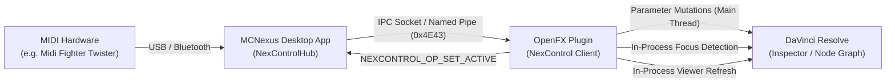

# NexControl SDK Integration Guide (OpenFX)

This guide documents how to integrate the **NexControl** real-time MIDI hardware control subsystem into native OpenFX plugins for DaVinci Resolve Studio (macOS and Windows).

---

## 1. Architecture Overview

NexControl is designed for **Zero Configuration for Colorists** and **Minimal Friction for Plugin Developers**.



### Core Features

1. **Hardware Connection & Transport**:
   The plugin does not link MIDI drivers or manage device connections. The background desktop service (**[MCNexus](https://github.com/ciqueira/MCNexus)** / `NexControlHub`) enumerates physical controllers via `libremidi` and transmits relative deltas over low-latency binary IPC (Unix Domain Sockets on macOS, Named Pipes on Windows).
2. **3-Tier Hardware Profile Abstraction**:
   - **Tier 1 (Custom Profiles)**: User-defined JSON files placed in `~/Library/Application Support/MCNexus/profiles/` (macOS) or `%APPDATA%\MCNexus\profiles\` (Windows) validated against `schemas/midi-device-profile.schema.json`, with live hot-reloading.
   - **Tier 2 (Factory Certified)**: Native built-in support for devices such as **Midi Fighter Twister** (4 banks, 64 encoders via Binary Offset 64, click push reset on CC 0..15 value 127).
   - **Tier 3 (Universal Generic Fallback)**: 1:1 CC fallback filtering reserved MIDI CCs (0, 32, 120..127).
3. **In-Process Active Node Tracking**:
   The active node is tracked **in-process** directly within DaVinci Resolve's memory via UI event hooks. **Zero Accessibility permissions required and zero cross-process polling.** Only the node currently focused in the Inspector receives mutations; all inactive nodes remain silent.
4. **Multi-Plugin Node Isolation**:
   Instance IDs are automatically managed with process-level isolation. Multiple distinct OFX plugins (such as creative grading tools and custom DCTL runners) running on the same timeline receive unique instance identifiers, preventing cross-plugin parameter conflicts.
5. **In-SDK Timeline Viewer Refresh**:
   When the timeline is paused, Resolve does not refresh GPU frames for API-driven slider changes alone. NexControl performs an in-process refresh of the timeline viewer without external scripts or network sockets.
6. **Thread Safety & Smooth Stepping**:
   Parameter adjustments are dispatched safely on the host's main UI thread. Continuous sliders (`Double`) offer smooth incremental adjustments, while discrete controls (`Choice` and `Integer`) feature sequential option stepping with automatic boundary clamping.

---

## 2. Parameter Types

When registering a parameter with `m_nexcontrolBinding->addParam()`, provide the control type (`param_type`):

| Type (`uint8_t`) | OpenFX Type | Rotation Action | Click Action (Push Switch) |
| :---: | :--- | :--- | :--- |
| **`1`** | `kOfxParamTypeDouble` | Continuous smooth increment/decrement (`±0.01` per tick). | **Immediate reset** to `default_value`. |
| **`2`** | `kOfxParamTypeInteger` | Discrete integer step (`+1` or `-1` per tick) with clamping. | **Immediate reset** to `default_value`. |
| **`3`** | `kOfxParamTypeBoolean` | Step toggle based on rotation direction. | **Toggle On/Off** (`0 ↔ 1`). |
| **`4`** | `kOfxParamTypeChoice` | Sequential navigation across dropdown options with clamping. | **Immediate reset** to default choice index. |

---

## 3. Step-by-Step Plugin Integration

### Step 1: Include Headers and Declare Class Members

In your plugin header (e.g. `MyPlugin.h`):

```cpp
#include "MCNexControl.h"
#include <memory>

class MyPlugin : public OFX::ImageEffect {
public:
    MyPlugin(OfxImageEffectHandle p_Handle);
    virtual ~MyPlugin();

private:
    // Status anchor parameter (Required for in-process node identification)
    OFX::StringParam *m_InstanceInfo = nullptr;

    // Instance binding lifecycle holder
    std::unique_ptr<mc::nexcontrol::InstanceBinding> m_nexcontrolBinding;
};
```

---

### Step 2: Define the Anchor in `describeInContext`

In your Factory descriptor (e.g. `MyPluginFactory::describeInContext`):

```cpp
void MyPluginFactory::describeInContext(OFX::ImageEffectDescriptor &p_Desc,
                                        OFX::ContextEnum p_Context) {
    // ... Define your regular parameters (gain, gamma, saturation, etc.) ...

    // Define NexControl Group (closed by default in Inspector)
    OFX::GroupParamDescriptor *grpNexControl = p_Desc.defineGroupParam("grpNexControl");
    grpNexControl->setLabels("NexControl", "NexControl", "NexControl");
    grpNexControl->setOpen(false);
    page->addChild(*grpNexControl);

    // Anchor string parameter inside the NexControl group
    OFX::StringParamDescriptor *instParam = p_Desc.defineStringParam("instance_info");
    instParam->setLabels("Status", "Status", "Status");
    instParam->setStringType(OFX::eStringTypeSingleLine);
    instParam->setDefault("Node Instance (Inactive)");
    instParam->setEnabled(false);       // Read-only (grayed out in Inspector)
    instParam->setIsPersistant(false);   // CRITICAL: Never persist in project files (.drp)
    instParam->setParent(*grpNexControl);
    page->addChild(*instParam);
}
```

> [!CAUTION]
> Never set `instParam->setIsSecret(true)`. If marked secret, DaVinci Resolve will not instantiate the UI widget in the Inspector, preventing the in-process tracker from detecting focus and silencing MIDI events for this node.

---

### Step 3: Initialize in the Instance Constructor

In your plugin constructor (e.g. `MyPlugin.cpp`):

```cpp
namespace OFX {
  namespace Private {
    extern OfxHost *gHost;
  }
}

MyPlugin::MyPlugin(OfxImageEffectHandle p_Handle)
    : OFX::ImageEffect(p_Handle) {

    // 1. Initialize the NexControl subsystem (idempotent, thread-safe)
    mc::nexcontrol::init(OFX::Private::gHost);

    // 2. Allocate instance binding
    m_nexcontrolBinding = std::make_unique<mc::nexcontrol::InstanceBinding>(p_Handle);

    // 3. Register parameters (Slot 0, Slot 1, ...)
    // Signature: addParam(scriptName, paramType, min, max, dispMin, dispMax, defaultVal)
    m_nexcontrolBinding->addParam("exposure", 1, -5.0, 5.0, -5.0, 5.0, 0.0);
    m_nexcontrolBinding->addParam("contrast", 1,  0.0, 2.0,  0.0, 2.0, 1.0);
    m_nexcontrolBinding->addParam("color_mode", 4, 0.0, 5.0, 0.0, 5.0, 0.0); // Choice
    m_nexcontrolBinding->addParam("bypass", 3, 0.0, 1.0, 0.0, 1.0, 0.0);     // Bool

    // 4. Update the beacon parameter with the unique instance ID
    m_InstanceInfo = fetchStringParam("instance_info");
    if (m_InstanceInfo && m_nexcontrolBinding) {
        std::string beaconText = "Node Instance (ID: " + 
                                 std::to_string(m_nexcontrolBinding->instance_id()) + ")";
        try { 
            m_InstanceInfo->setValue(beaconText); 
        } catch (...) {}
    }
}
```

---

### Step 4: Cleanup in the Destructor

In your plugin destructor:

```cpp
MyPlugin::~MyPlugin() {
    m_nexcontrolBinding.reset(); // Automatically unregisters slot and unbinds IPC
}
```

---

## 4. Hardware Profiles & Customization

NexControl supports dynamic profile definition using the formal JSON schema:
[`schemas/midi-device-profile.schema.json`](../schemas/midi-device-profile.schema.json).

Users or manufacturers can create custom profiles in:
- macOS: `~/Library/Application Support/MCNexus/profiles/<model>.json`
- Windows: `%APPDATA%\MCNexus\profiles\<model>.json`

Profiles configure encoder modes (`twos_complement`, `binary_offset_64`), CC ranges, MIDI channels, banks, and push switch actions without requiring plugin recompilation.
